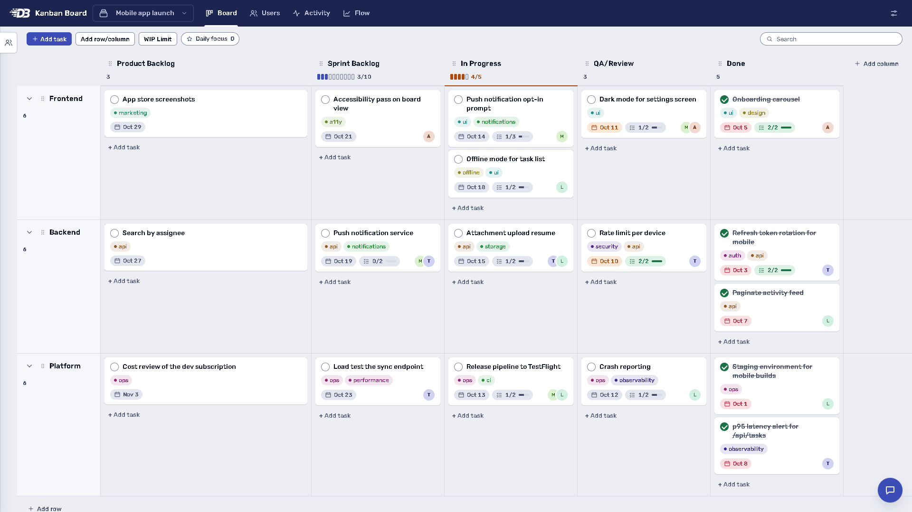
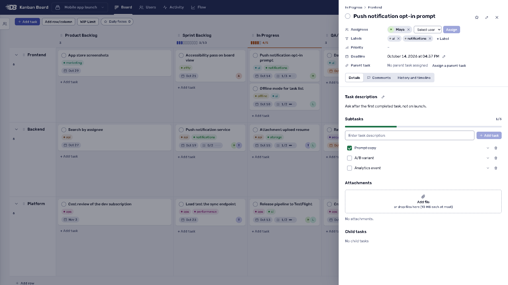
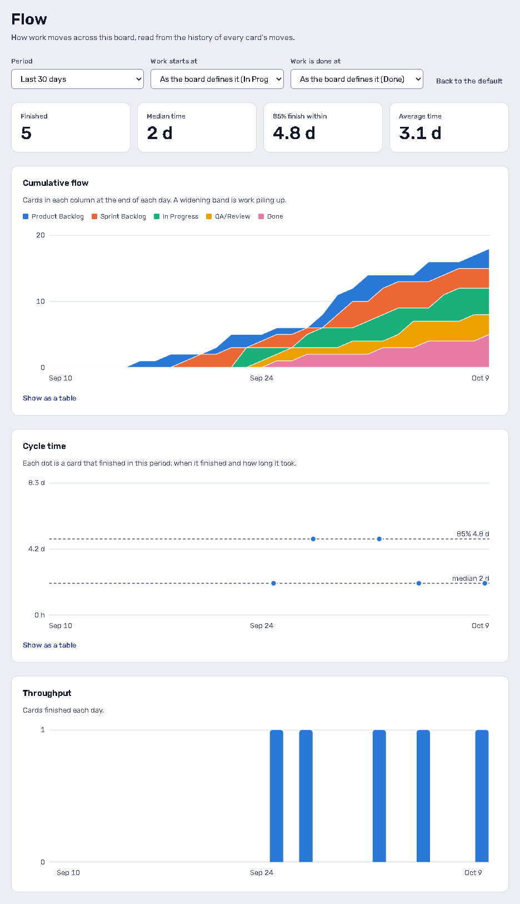
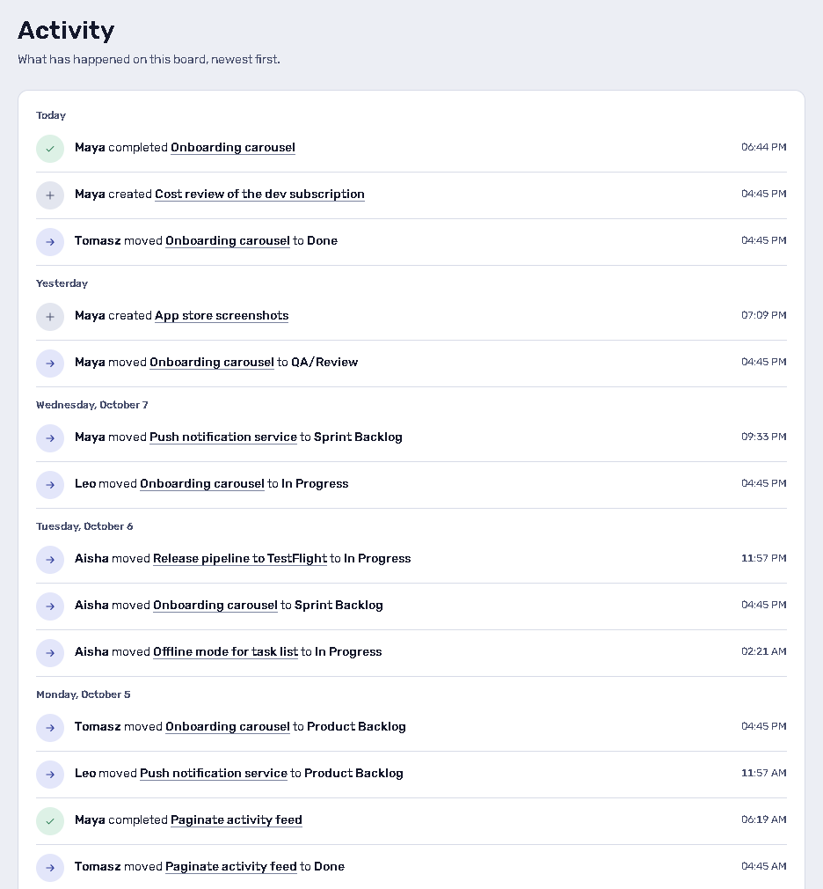
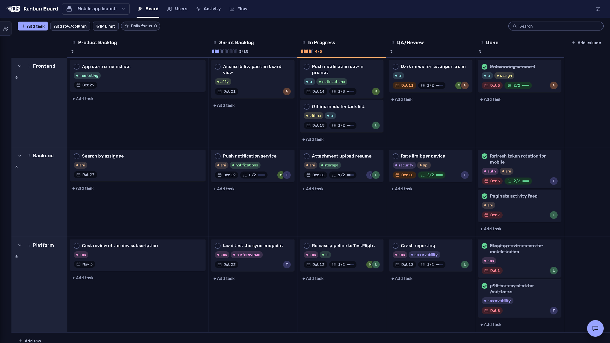
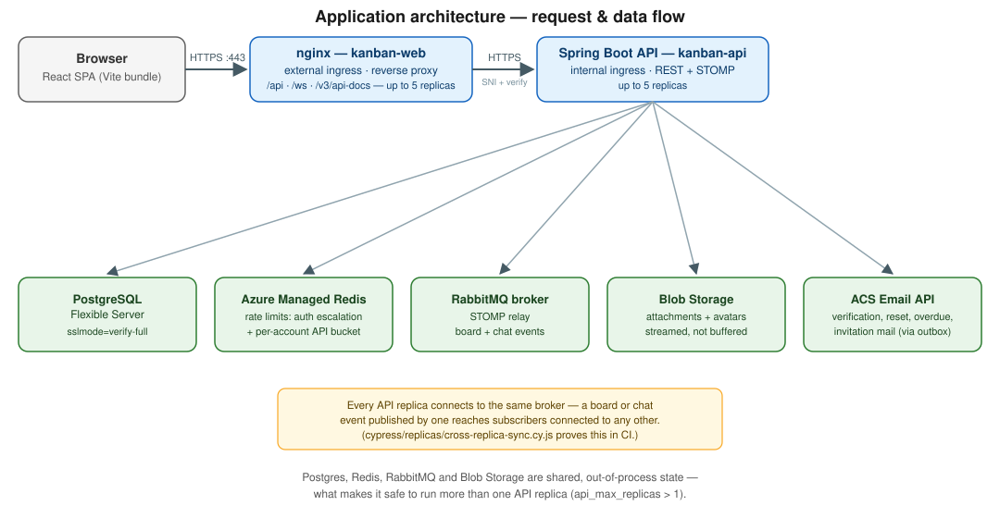
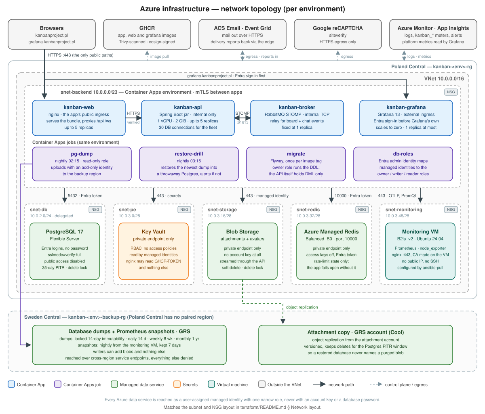
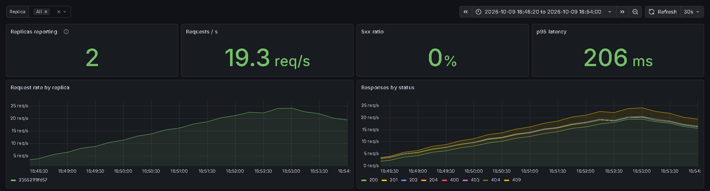
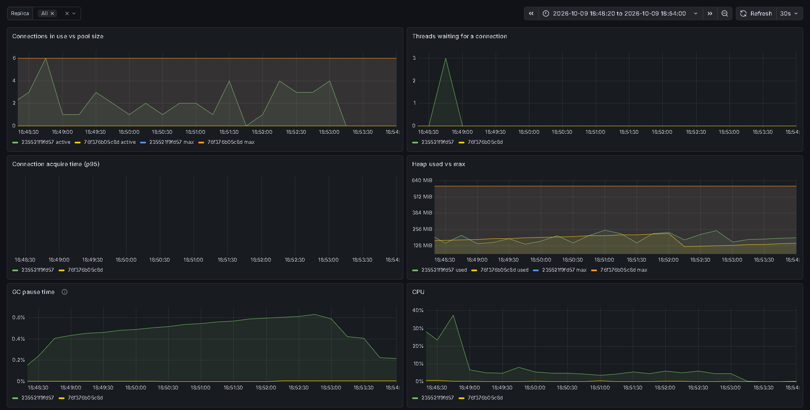
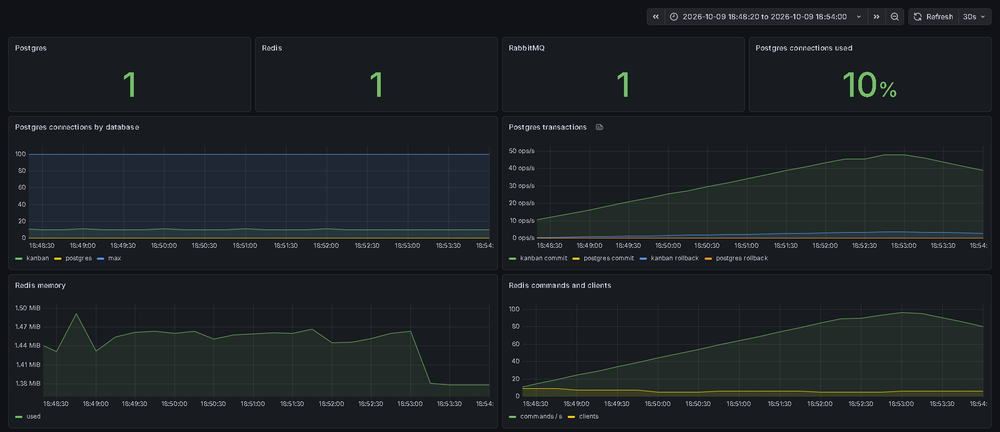

<p align="center">
  
</p>

<h1 align="center">KanbanProject</h1>

<p align="center">
  
  
  
  
  
</p>

<p align="center">
  A Kanban board for small teams: columns, swimlanes, WIP limits, drag and drop, and live updates
  for everyone looking at the same board.
</p>

## Contents

- [What it does](#what-it-does)
- [Screenshots](#screenshots)
- [Tech stack](#tech-stack)
- [Prerequisites](#prerequisites)
- [Running it](#running-it)
  - [With Docker](#with-docker)
  - [Running Locally](#running-locally)
- [Using the board](#using-the-board)
- [Project layout](#project-layout)
- [Deployment and infrastructure](#deployment-and-infrastructure)
- [Testing](#testing)
- [Contributing](#contributing)
- [Authors](#authors)
- [License](#license)

## What it does

We built KanbanProject to manage our own work the Kanban way. You lay out your workflow as columns,
split it into swimlanes, and move cards across as work progresses. It has:

- a drag-and-drop board with columns and rows (swimlanes), which also works from the keyboard
- cards with subtasks, assignees, labels, deadlines and file attachments
- WIP limits on columns, rows and people
- live sync, so a change on one screen shows up on every other screen watching the board
- flow metrics built from every card's move history: cumulative flow, cycle time and throughput
- an activity feed of who moved, assigned, completed or commented on what
- dark mode that follows your operating system

## Screenshots

<p align="center">
  
</p>

<p align="center">
  
</p>

<table>
  <tr>
    <td width="50%"></td>
    <td width="50%"></td>
  </tr>
  <tr>
    <td align="center">Flow metrics</td>
    <td align="center">Activity feed</td>
  </tr>
</table>

<p align="center">
  
</p>

## Tech stack

- **Backend**: Spring Boot 4.1 on Java 21 (built and run on JDK 25)
- **Frontend**: React 19 and Vite 8
- **Data**: PostgreSQL, with Redis for rate limiting and RabbitMQ relaying live updates
- **Files**: Azure Blob Storage (Azurite locally)
- **Infrastructure**: Docker, Terraform on Azure Container Apps, Prometheus and Grafana
- **Testing**: JUnit, Mockito and JaCoCo on the backend; Jest, ESLint and Cypress on the frontend;
  k6 for load tests

## Prerequisites

- A JDK, 21 or newer. The code targets Java 21; CI and the Docker build use
  [Temurin 25](https://adoptium.net/).
- [Node.js 26](https://nodejs.org/), which is what CI and the Docker build use. Vite 8 runs on 20.19
  and up, but we only run Jest on 26, and on Node 22 seven `HomePage.test.jsx` tests fail.
- [npm](https://www.npmjs.com/) or [Yarn](https://yarnpkg.com/)
- To run the backend outside Docker: [PostgreSQL](https://www.postgresql.org/),
  [Redis 7](https://redis.io/) and [RabbitMQ 4](https://www.rabbitmq.com/) with the STOMP plugin
  (see [Running Locally](#running-locally))
- To use containers: [Docker](https://www.docker.com/) and
  [Docker Compose](https://docs.docker.com/compose/)

Clone the repo first:

```bash
git clone https://github.com/dominiksmolinski3/KanbanProject.git
cd KanbanProject
```

## Running it

### With Docker

This is the easiest way, since Compose brings up everything the app depends on.

1. From the repository root, create your environment file and fill it in:

```bash
cp .env.example .env
```

2. Start the stack:

```bash
docker-compose up -d
```

3. Open [http://localhost:8080](http://localhost:8080).

   That port is the `web` service: nginx serving the built frontend and proxying `/api`, `/ws` and
   `/v3/api-docs` to the `app` container, the same layout as the real deployment. The API also
   listens on `127.0.0.1:8081` if you want to talk to it directly. `/actuator` isn't proxied, so
   asking `:8080` for it gives a 404 on purpose.

   A few extras:

   - `docker compose --profile replicas up -d` adds a second API replica on `127.0.0.1:8082`, with
     the same image and settings, sharing the same Postgres, Redis and RabbitMQ. That's how the
     deployment runs more than one replica, and `cypress/replicas/cross-replica-sync.cy.js` needs it.
   - [Azurite](https://learn.microsoft.com/azure/storage/common/storage-use-azurite), the Blob
     Storage emulator, comes up too, so attachments work without an Azure subscription. It publishes
     no port; only the app talks to it. To use real storage, set `AZURE_STORAGE_CONNECTION_STRING`
     in `.env`. With no storage at all, the app still starts and refuses uploads with a 503.
   - A plain `redis` service holds the login and signup rate limits, so they stay correct across
     replicas. There's nothing to configure.
   - `docker compose --profile monitoring up -d` adds Prometheus (`127.0.0.1:9090`) and Grafana
     (`127.0.0.1:3000`, anonymous read-only) with the same dashboards we deploy, plus exporters for
     Postgres, Redis and the edge. The API pushes metrics to Prometheus over OTLP, as it does in
     Azure.

4. To stop it:

```bash
docker-compose down
```

### Running Locally

#### Backend

1. From the repository root:

```bash
cd backend
```

2. Set up the database and secrets.

   `application.properties` reads every secret from the environment and also loads an optional
   `.env` from the working directory, so **don't put credentials in `application.properties`**.
   Copy the template and fill that in instead:

```bash
cp .env.example .env
```

   | Variable | What it is |
   | --- | --- |
   | `SPRING_DATASOURCE_URL` | JDBC URL, e.g. `jdbc:postgresql://localhost:5432/kanban` |
   | `SPRING_DATASOURCE_USERNAME` | PostgreSQL user |
   | `SPRING_DATASOURCE_PASSWORD` | PostgreSQL password |
   | `JWT_SECRET_KEY` | JWT signing key; generate one with `openssl rand -base64 32` |
   | `ACS_EMAIL_CONNECTION_STRING` | Azure Communication Services connection string (portal -> your resource -> Keys). Leave empty to turn mail off |
   | `ACS_EMAIL_SENDER_ADDRESS` | The sender address on the linked domain, e.g. `DoNotReply@<guid>.azurecomm.net` |
   | `SECURITY_RATE_LIMIT_REDIS_HOST` / `_PORT` | Redis for the rate limiters. Defaults to `localhost:6379` |
   | `STOMP_RELAY_HOST` / `_PORT` | RabbitMQ's STOMP listener. Defaults to `localhost:61613` |
   | `STOMP_RELAY_USERNAME` / `_PASSWORD` | Broker login. The default `guest`/`guest` only works from the broker's own host, so a broker in Docker needs a real user |

   `.env` is gitignored. Docker Compose uses a separate `.env` in the repository root (see
   [With Docker](#with-docker)).

3. Start Redis and RabbitMQ. The API needs both: Redis holds the rate limits and RabbitMQ relays live
   board updates and chat. Without Redis the limits stop applying. Without RabbitMQ the API still
   starts, but updates and chat messages never reach other screens, and nothing on the page tells
   you why. Two containers are the quickest way:

```bash
docker run -d --name kanban-redis -p 6379:6379 redis:7-alpine
docker run -d --name kanban-rabbitmq -p 61613:61613 \
  -e RABBITMQ_DEFAULT_USER=kanban -e RABBITMQ_DEFAULT_PASS=kanban \
  rabbitmq:4-alpine sh -c "rabbitmq-plugins enable --offline rabbitmq_stomp && exec docker-entrypoint.sh rabbitmq-server"
```

   Then set `STOMP_RELAY_USERNAME=kanban` and `STOMP_RELAY_PASSWORD=kanban` in `.env`. If something
   already uses port 6379, publish Redis on another port and set `SECURITY_RATE_LIMIT_REDIS_PORT`.

4. Build and run:

```bash
./mvnw clean package
./mvnw spring-boot:run
```

The backend starts on [http://localhost:8080](http://localhost:8080). On Windows, use `mvnw.cmd`
instead of `./mvnw`.

#### Frontend

1. From the repository root:

```bash
cd frontend
```

2. Install dependencies:

```bash
npm ci
```

3. Start the dev server:

```bash
npm run dev
```

The frontend runs on [http://localhost:5173](http://localhost:5173) and proxies API calls to the
backend on `:8080`.

## Using the board

1. Create columns for your workflow stages, e.g. "To Do", "In Progress", "Done".
2. Add rows to group work by type or project.
3. Add a task with the "Add Task" button.
4. Drag tasks between columns as they move along.
5. Click a task to see its details, add subtasks or assign people.
6. Set WIP limits on columns so no stage gets overloaded.

## Project layout

- `backend/`: the Spring Boot application
  - `src/main/java`: source, one package per feature
  - `src/main/resources`: configuration and Flyway migrations
  - `src/test`: tests
- `frontend/`: the React application ([frontend/README.md](frontend/README.md) covers the board UI
  and its design tokens)
  - `src/components`: React components
  - `src/board`: the board's view model and hooks (WIP state, card metadata, swimlane collapse)
  - `src/services`: API calls, one module per feature
  - `src/styles`: CSS
- `terraform/`: the Azure infrastructure ([terraform/README.md](terraform/README.md))
- `observability/`: Prometheus, Grafana and the monitoring VM's configuration
- `loadtest/`: k6 scenarios
- `.github/workflows/`: CI/CD
- `docs/`: architecture notes and diagrams ([docs/architecture.md](docs/architecture.md) explains
  why things are built the way they are)

## Deployment and infrastructure

### How a request flows

<p align="center">
  
</p>

Browsers only ever talk to **nginx**, the app's single public address. It serves the built frontend
and proxies `/api`, `/ws` and `/v3/api-docs` to the **Spring Boot API** over an internal TLS
connection. Only the API talks to the shared services: Postgres, Azure Managed Redis, the RabbitMQ
STOMP broker, Blob Storage and the ACS Email API. Because all shared state lives in those services,
both nginx and the API can run several replicas. Every API replica pushes its metrics over OTLP to
**Prometheus**, and **Grafana** reads them from there.

### Azure

<p align="center">
  
</p>

Every push to `main` builds three images, scans each with Trivy and publishes them to the GitHub
Container Registry:

- [backend/Dockerfile](backend/Dockerfile): the Spring Boot jar
- [frontend/Dockerfile](frontend/Dockerfile): nginx with the Vite bundle
- [observability/grafana/Dockerfile](observability/grafana/Dockerfile): Grafana with our dashboards

```bash
docker pull ghcr.io/dominiksmolinski3/kanbanproject-app:latest
docker pull ghcr.io/dominiksmolinski3/kanbanproject-web:latest
docker pull ghcr.io/dominiksmolinski3/kanbanproject-grafana:latest
```

Images are tagged with the commit SHA, and `:latest` only moves once the scan passes. **All three
always share a tag.** The frontend and the API used to ship as one artifact and couldn't get out of
sync; one shared tag keeps it that way.

In Azure, four Container Apps run in one environment:

- **`kanban-web`**: nginx and the only public entry point
- **`kanban-api`**: the Spring Boot app, internal only, up to 5 replicas
- **`kanban-broker`**: RabbitMQ with STOMP, a single replica that every API replica connects to
- **`kanban-grafana`**: behind an Entra sign-in, scaled to zero when nobody's using it

Each runs as its own managed identity. PostgreSQL Flexible Server sits in a delegated subnet with no
public access and Entra-only logins. Redis, Key Vault and the storage account are closed to the
internet and reached over private endpoints, without account keys. Container Apps jobs run the
Flyway migrations, a nightly `pg_dump` and a nightly restore drill. The dumps and a replicated copy
of the attachments live in a second region (Sweden Central). Prometheus runs on a small VM with no
public IP and no SSH. It only accepts 443 from the Container Apps subnet, is configured by Ansible
through Run Command, and sends a nightly snapshot to the backup region.

All of it is Terraform in [terraform/](terraform/).
[terraform/README.md](terraform/README.md) covers the RBAC you need, the network layout, and the
reasoning behind most of the settings.

Right now nothing is deployed: we took the dev environment down to save Azure credits. The
Terraform state is kept, so it can be rebuilt with one apply.

### Monitoring

Grafana comes with dashboards for the API, the JVM and its connection pool, the app's own counters
(mail outbox, rate-limit refusals, edit conflicts), the shared infrastructure, the edge and the
monitoring VM, plus an Azure Monitor dashboard for the managed services. These screenshots come from
the local `monitoring` profile, with two API replicas under a k6 smoke run.

<p align="center">
  
</p>

<p align="center">
  
</p>

<p align="center">
  
</p>

### Workflows

Everything lives in [.github/workflows/](.github/workflows/):

| Workflow | What it does |
| --- | --- |
| `kanban-ci.yml` | Backend tests against Postgres and Redis, frontend build, lint and Jest, Cypress against a two-replica Compose stack, and a Trivy scan of every image on every PR |
| `kanban-cd.yml` | Builds, scans, pushes and promotes the images |
| `deployed-contract.yml` | Checks every day that the deployed site still matches `main` |
| `codeql.yml` | CodeQL on the Java backend |
| `migration-order.yml` | Keeps Flyway migration numbers in order across branches |
| `terraform-ci.yml` | `fmt`, `validate` and Checkov |
| `terraform-drift.yml` | Plans dev from `main` every night |
| `observability-ci.yml` | Prometheus config and rule tests, dashboard lint, ansible-lint and Molecule |
| `monitoring-drift.yml` | A nightly check-mode run of the monitoring VM's configuration |
| `hadolint.yml` | Lints every Dockerfile |
| `sweep-alarm.yml` | The shared alarm every scheduled workflow reports through |
| `dependency-review.yml`, `dependabot-auto-merge.yml`, `dependency-scan.yml`, `external-scan.yml`, `dast.yml` | Dependency and attack-surface scanning |

`deployed-contract.yml`, `terraform-drift.yml`, `monitoring-drift.yml` and `external-scan.yml` are
disabled while nothing is deployed.

## Testing

We use JUnit, Mockito, Jest, ESLint and Cypress, and JaCoCo for coverage. CI runs everything on every
pull request and every push to `main`.

### Backend

From the repository root:

```bash
cd backend
./mvnw test              # on Windows: mvnw.cmd test
```

For a coverage report:

```bash
./mvnw clean test jacoco:report
```

It ends up in `backend/target/site/jacoco/index.html`. CI runs `./mvnw verify`, which also enforces
a coverage floor for each package.

### Frontend

From the repository root:

```bash
cd frontend
npm test                  # Jest unit tests
npm run test:coverage     # Jest with a coverage report
npm run lint              # ESLint
npm run cypress:open      # Cypress, interactive
npm run cypress:run       # Cypress, headless in Chromium (no Chromium? append: -- --browser chrome)
npm run cypress:run:replicas   # the specs that need two API replicas (see below)
```

The Jest coverage report goes to `frontend/coverage`. Cypress drives the app over HTTP, so start the
backend (`:8080`) and the Vite dev server (`:5173`) first.

`cypress/replicas/` holds specs that need more than a plain stack, so it sits outside the default spec
pattern and `npm run cypress:run` doesn't pick it up. `cross-replica-sync.cy.js` checks that a board
event published by one API replica reaches a browser connected to the other. With only one replica
that test would prove nothing, so bring the stack up with
`docker compose --profile replicas up -d` first. The spec writes to the second replica's own port
(`127.0.0.1:8082`) while the browser goes through nginx to the first.

### Load testing

[k6](https://grafana.com/docs/k6/latest/) scenarios live in `loadtest/` and run against the Compose
stack. Run these from the repository root after `npm ci` in `frontend/` (the seed script uses its
`pg` package):

```bash
docker compose -f docker-compose.yml -f loadtest/docker-compose.loadtest.yml --profile replicas --profile monitoring up -d --build
set -a && . ./.env && set +a      # the seed reads the Postgres credentials from SPRING_DATASOURCE_*
node loadtest/seed.mjs            # 20 verified accounts on one board with 300 cards
docker compose --profile loadtest run --rm --no-deps k6                        # 60 s smoke
docker compose --profile loadtest run --rm --no-deps -e LOAD_PROFILE=load k6   # 9 min at 4x the smoke rate
```

`LOAD_PROFILE` can be `smoke`, `load`, `stress` or `spike`, and `LOAD_RATE_SCALE`, `LOAD_DURATION` and
`LOAD_P95_MS` tune it. A run fails on any 5xx, on more than 1% unexpected responses, or when p95 goes
over the profile's limit. Watch it on the **Load test** dashboard in Grafana
(`http://localhost:3000`). The override turns mail and captcha off and spreads traffic over both API
replicas. Access tokens last 15 minutes, so seed again before each run.

## Contributing

We're happy to take pull requests. A few things make them easier to merge:

1. Fork the repo and branch off the latest `main` (`feat/<what>`, `fix/<what>`, `docs/<what>`, ...).
   Please don't branch off another open PR; stacked PRs get no CI.
2. Write commit messages as [Conventional Commits](https://gist.github.com/qoomon/5dfcdf8eec66a051ecd85625518cfd13),
   e.g. `feat(board): add swimlane filter`.
3. Run the tests for whatever you touched (`./mvnw verify`, `npm test`, `npm run lint`).
4. Open the pull request against `main`.

[CLAUDE.md](CLAUDE.md) lists the conventions and the easy-to-miss traps, and
[docs/architecture.md](docs/architecture.md) explains the reasons behind them.

## Authors

- **Daniel Rudziński**: [GitHub](https://github.com/danielrudzinski)
- **Dominik Smoliński**: [GitHub](https://github.com/dominiksmolinski3)

## License

MIT. See [LICENSE](LICENSE).
